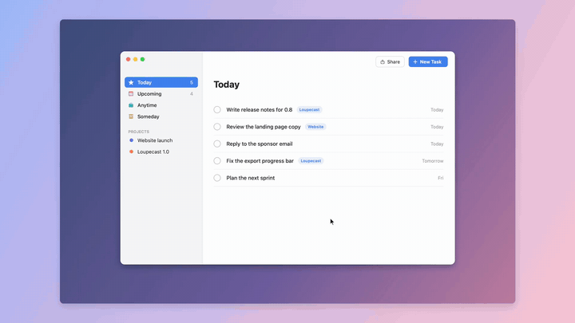

<h1 align="center">Loupecast</h1>
<p align="center">A free, open-source macOS screen recorder that zooms in where you click, lets you cut the boring parts, and exports a polished 1080p60 MP4.</p>
<p align="center">
  <a href="https://dunzkoi.github.io/loupecast/en/">Website</a> ·
  <a href="https://github.com/dunzkoi/loupecast/releases/latest">Download</a> ·
  <a href="https://github.com/sponsors/dunzkoi">Sponsor</a> ·
  <a href="README.ko.md">한국어</a>
</p>
<p align="center"></p>

## Install

With Homebrew:

```sh
brew install --cask dunzkoi/tap/loupecast
```

Or download `Loupecast.zip` from the [latest release](https://github.com/dunzkoi/loupecast/releases/latest), unzip it, and move `Loupecast.app` to `/Applications`.

> Loupecast is not notarized yet, so macOS may say the app "is damaged" or "can't be opened". Run this once:
>
> ```sh
> xattr -dr com.apple.quarantine /Applications/Loupecast.app
> ```

Requires macOS 15 or later on Apple Silicon. The interface is in English or Korean, following your macOS language.

## Usage

1. Open Loupecast. It lives in the menu bar (◉), not the Dock.
2. Press **⌘⇧2** (or choose **Start Recording** from the menu) to start, and again to stop.
3. The first time, allow **Screen & System Audio Recording** in System Settings, then quit and reopen Loupecast.
4. When you stop, the editor opens:
   - Clicks become automatic zooms. Select a zoom and press Delete to remove it, or use **Add Zoom** to add one.
   - **D** splits at the playhead, click a clip and press **Delete** to cut it, **⌘Z** to undo.
   - **Space** plays, **← →** step one frame, **I / O** set the clip start and end.
5. Pick the frame next to it (16:9, 9:16 for Shorts and Reels, or 1:1), then press **Export**. Files go to `~/Movies`.

Menu toggles: **Record Microphone** (off by default), **Record Computer Audio** (on), **Hide Menu Bar in Video** (crops the menu bar out of the video, on).

## Privacy

The only network request Loupecast makes is an update check against GitHub Releases at launch and then daily (`api.github.com`), plus the download when an update exists. Recordings stay in `~/Library/Application Support/Loupecast/Recordings` and exports in `~/Movies`. Nothing is uploaded, and there is no analytics or telemetry.

## Build from source

```sh
git clone https://github.com/dunzkoi/loupecast.git
cd loupecast
swift test
./build.sh          # → dist/Loupecast.app
```

Needs Xcode 16 or later. No third-party dependencies.

## FAQ

**Do I have to allow screen recording again after an update?** No. Since 0.3.1 every release is signed with the same certificate, so macOS keeps the permission after an update. Coming from 0.3.0 or earlier, you may have to turn it on once more: when you start recording, Loupecast clears the old entry once by itself, so just turn it on when macOS asks.

**The menu bar icon doesn't show up.** macOS may hide new menu bar items when the bar is full. Check System Settings → Menu Bar, or just press ⌘⇧2.

## Contributing

Bug reports and PRs are welcome. Read [CONTRIBUTING.md](CONTRIBUTING.md) first; every PR gets CI and an automated review.

## Sponsor

Loupecast is free and will stay free. If it saves you time, [sponsoring on GitHub](https://github.com/sponsors/dunzkoi) pays for new features, fixes and releases.

## License

[MIT](LICENSE) © 2026 Dunz Koi
